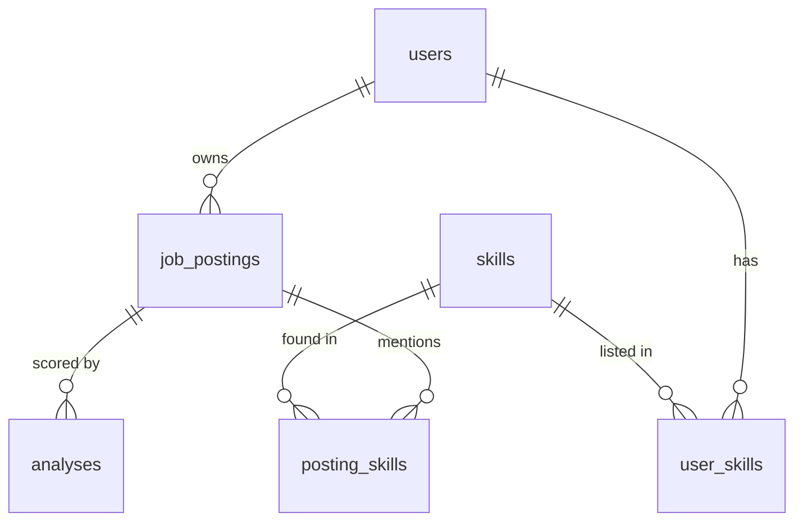

# JobFit

JobFit keeps the job postings I'm applying to next to my skills profile. It
scores how well I match each one with a SQL query over structured skills, then
has a local LLM explain the gaps from the posting text, quoting the lines it
used. FastAPI, SQLAlchemy, ChromaDB, Ollama and Streamlit, all started with
one `docker-compose up --build`.

This is the system design, done before writing any code. The proposal is in
[`../capstone-proposal/PROPOSAL.md`](../capstone-proposal/PROPOSAL.md).

## Architecture


**Communication.** Services talk over the default compose network by service
name (`backend`, `postgres`, `ollama`). Inside a container `localhost` is that
container. Streamlit calls the API from its own Python process, so the JWT
stays server-side and never reaches the browser. No volume is shared: each
named volume belongs to one service.

**Asking a question:**

1. The user types a question on the Ask page.
2. Streamlit sends `POST http://backend:8000/ask` with the Bearer token.
3. FastAPI validates the body, decodes the JWT and loads the user.
4. The backend embeds the question and queries ChromaDB, filtered to that user's postings.
5. Chunks that are too far away, or belong to postings no longer in Postgres, are dropped. If none are left, the answer says so without calling the LLM.
6. The remaining chunks are numbered and put in a prompt with the question.
7. The prompt goes to Ollama (`/api/chat`, `llama3.2:1b`).
8. The backend checks the answer's `[n]` citations, scores confidence (high/medium/low) and returns the answer with its sources.
9. Streamlit renders the answer, a confidence badge and the source excerpts.

**Storage.**

| Store | Holds | Volume |
|---|---|---|
| PostgreSQL 17 (SQLAlchemy) | users, skills catalogue, postings, posting and user skills, analyses | `postgres_data` |
| ChromaDB, embedded in the backend | posting chunks, 384-dim embeddings, `user_id`/`job_id` metadata | `chroma_data` |
| Ollama | `llama3.2:1b` weights | `ollama_data` |

Postgres is the source of truth. ChromaDB is an index rebuilt from it
(`POST /jobs/reindex`). All three volumes survive `docker-compose down` and
image rebuilds; only `down -v` deletes them. Outside Docker the backend falls
back to SQLite and a local `./chroma` folder, which is also what the tests use.

## Database schema



| Model / table | Fields | Relationships |
|---|---|---|
| `User` / `users` | `id` int PK, `username` str(50) unique, `hashed_password` str(255), `created_at` datetime | 1→N `job_postings` (cascade delete), N↔N `skills` via `user_skills` |
| `Skill` / `skills` | `id` int PK, `name` str(100) unique, `category` str(50) | seeded from `seed/skills.csv` |
| `user_skills` (link table) | `user_id` FK PK, `skill_id` FK PK, `added_at` datetime | user CASCADE, skill RESTRICT |
| `JobPosting` / `job_postings` | `id` int PK, `user_id` FK, `title` str(200), `company` str(200), `location` str(200)?, `url` str(500)?, `source` str(10), `text` text, `content_hash` str(64), `indexed_at` datetime?, `created_at`, `updated_at` | N→1 user; 1→N `posting_skills`, `analyses` (cascade delete); unique (`user_id`, `content_hash`) |
| `PostingSkill` / `posting_skills` | `job_posting_id` FK PK, `skill_id` FK PK, `requirement` `required`/`preferred`, `evidence` text | posting CASCADE, skill RESTRICT |
| `Analysis` / `analyses` | `id` int PK, `job_posting_id` FK, `match_score` float 0-1, `matched_skills` JSON, `missing_skills` JSON, `explanation` text?, `citations` JSON, `status` `complete`/`score_only`, `model_name` str?, `created_at` | N→1 posting (CASCADE) |

`?` = nullable. Deleting a user removes their postings, posting skills,
analyses and user skills through `ON DELETE CASCADE`, then their chunks in
ChromaDB. The match score is the weighted share of a posting's skills the user
has (required counts 2, preferred 1), computed in one SQL query.

## API endpoints

Only `/health` and `/auth/*` are public. Everything else needs
`Authorization: Bearer <token>` (30-minute HS256 JWT). Another user's posting
returns 404, the same as a missing one.

| Method | Path | Auth | Request schema | Response schema |
|---|---|---|---|---|
| GET | `/health` | no | none | `HealthResponse` (ok / degraded / down) |
| POST | `/auth/register` | no | `UserCreate` | `UserOut` (201) |
| POST | `/auth/token` | no | `OAuth2PasswordRequestForm` (form fields) | `Token` |
| GET | `/me` | yes | none | `UserOut` |
| DELETE | `/me` | yes | none | 204 |
| GET | `/skills` | yes | none | `list[SkillOut]` |
| GET | `/me/skills` | yes | none | `list[SkillOut]` |
| PUT | `/me/skills` | yes | `SkillsUpdate` | `list[SkillOut]` |
| GET | `/jobs` | yes | query `limit`, `offset` | `list[JobSummary]` |
| POST | `/jobs` | yes | `JobCreate` | `JobOut` (201) |
| POST | `/jobs/samples` | yes | none | `SamplesResult` |
| POST | `/jobs/reindex` | yes | none | `ReindexResult` |
| GET | `/jobs/{job_id}` | yes | none | `JobOut` |
| PATCH | `/jobs/{job_id}` | yes | `JobUpdate` | `JobOut` |
| DELETE | `/jobs/{job_id}` | yes | none | 204 |
| POST | `/jobs/{job_id}/analyze` | yes | none | `AnalysisOut` (201) |
| GET | `/jobs/{job_id}/analyses` | yes | none | `list[AnalysisOut]` |
| GET | `/recommendations` | yes | query `limit` | `list[Recommendation]` |
| POST | `/ask` | yes | `AskRequest` | `AskResponse` |

Pydantic schemas (`?` = optional):

| Schema | Fields |
|---|---|
| `UserCreate` | `username` 3-50 chars (letters, digits, `_.-`, stored lowercase), `password` 8-128 chars |
| `UserOut` | `id`, `username`, `created_at` |
| `Token` | `access_token`, `token_type` (`bearer`), `expires_in` |
| `SkillOut` | `id`, `name`, `category` |
| `SkillsUpdate` | `skill_ids` (the full new set, max 200) |
| `JobCreate` | `title`, `company` (1-200 chars), `location`?, `url`?, `source` (`pasted`/`upload`), `text` (200-20,000 chars) |
| `JobUpdate` | same fields as `JobCreate`, all optional |
| `JobSummary` | `id`, `title`, `company`, `location`, `source`, `indexed`, `latest_score`, `created_at` |
| `JobOut` | `JobSummary` plus `url`, `text`, `skills` (skill, requirement, evidence line), `indexed_at`, `updated_at` |
| `SamplesResult` | `added`, `skipped` |
| `ReindexResult` | `indexed`, `failed` (job ids) |
| `AnalysisOut` | `id`, `job_id`, `match_score` (0-1), `matched_skills`, `missing_skills`, `explanation`?, `citations`, `status` (`complete`/`score_only`), `model_name`, `created_at` |
| `Recommendation` | `skill`, `category`, `postings`, `required_in` |
| `AskRequest` | `question` (3-500 chars), `job_ids`? (1-50 ids), `n_results` (1-10, default 5) |
| `AskResponse` | `answer`, `confidence` (`high`/`medium`/`low`), `sources` (job, chunk, excerpt, distance), `model` |
| `HealthResponse` | `status` (`ok`/`degraded`/`down`), `database`, `chroma`, `ollama`, `model_ready`, `model` |

## Docker Compose plan

```yaml
# pinned so the volume names don't depend on the folder name
name: jobfit

services:

  postgres:      # users, postings, skills, analyses
    image: postgres:17-alpine
    environment:
      POSTGRES_USER: ${POSTGRES_USER:-jobfit}
      POSTGRES_PASSWORD: ${POSTGRES_PASSWORD:-jobfit}
      POSTGRES_DB: ${POSTGRES_DB:-jobfit}
    volumes:
      - postgres_data:/var/lib/postgresql/data
    healthcheck:
      test: ["CMD-SHELL", "pg_isready -h 127.0.0.1 -U $${POSTGRES_USER} -d $${POSTGRES_DB}"]

  ollama:        # LLM runtime
    image: ollama/ollama
    ports:
      - "127.0.0.1:11435:11434"
    volumes:
      - ollama_data:/root/.ollama
    healthcheck:
      test: ["CMD", "ollama", "list"]

  ollama-pull:   # one-shot: pulls the model, warms it up, exits
    image: ollama/ollama
    environment:
      OLLAMA_HOST: http://ollama:11434
    entrypoint: ["/bin/sh", "-c"]
    command: ["ollama pull ${MODEL_NAME:-llama3.2:1b} && ollama run ${MODEL_NAME:-llama3.2:1b} 'Reply with OK' > /dev/null"]
    depends_on:
      ollama:
        condition: service_healthy

  backend:       # FastAPI + RAG pipeline, ChromaDB embedded
    build: ./backend
    ports:
      - "127.0.0.1:8000:8000"
    environment:
      DATABASE_URL: postgresql+psycopg://${POSTGRES_USER:-jobfit}:${POSTGRES_PASSWORD:-jobfit}@postgres:5432/${POSTGRES_DB:-jobfit}
      OLLAMA_URL: http://ollama:11434
      CHROMA_PATH: /app/chroma
    volumes:
      - chroma_data:/app/chroma
    depends_on:
      postgres:
        condition: service_healthy
      ollama:
        condition: service_healthy
        required: false   # Ollama down only takes out /ask, not the API

  frontend:      # Streamlit
    build: ./frontend
    ports:
      - "127.0.0.1:8501:8501"
    environment:
      BACKEND_URL: http://backend:8000
    depends_on:
      - backend

volumes:
  postgres_data:
  chroma_data:
  ollama_data:
```

Decisions:

- **ChromaDB is embedded in the backend**, not a separate service. It uses `PersistentClient` on the `chroma_data` volume. The backend is the only thing that reads or writes vectors, so a Chroma server would just add a container and a client/server version to keep in step. The trade-off is one uvicorn worker. Embeddings come from Chroma's built-in `all-MiniLM-L6-v2`, baked into the backend image, so saving and searching postings still work while Ollama is down or still pulling the model.
- **Ollama runs in a container**, reached by service name at `http://ollama:11434`, so a clean clone comes up with one `docker-compose up --build`. It's published on 11435 so it can't clash with an Ollama already running on the host. If CPU-only inference in Docker turns out too slow on the Mac, an override file points the backend at the host's Ollama through `http://host.docker.internal:11434` instead, with `extra_hosts: host-gateway` for Linux.
- **Volumes that persist:** `postgres_data` (database), `chroma_data` (vector index) and `ollama_data` (model weights). The backend doesn't wait for `ollama-pull`, so login and CRUD work during the first model download, and `/health` reports `degraded` until the model is ready.
